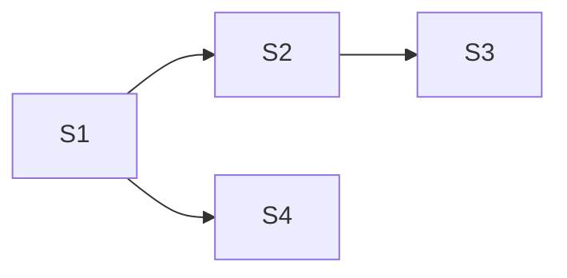

**Issue:** #232 — Table: focus position store member (table.focus, moveTo)
**Branch:** feat/232-store-focus-member
**Worktree:** .claude/worktrees/feat-232-store-focus-member

Dependency: S1 → S2 → S3 · Parallel-safe: S4 with S2/S3 after S1

| Step | Title                                                                   | Status  |
| ---- | ----------------------------------------------------------------------- | ------- |
| 1    | [Focus member: read and write](step-1-focus-member.plan.md)             | ✅ done |
| 2    | [Unrendered target degrades](step-2-unrendered-target-degrades.plan.md) | ✅ done |
| 3    | [Focus request counter](step-3-focus-request-counter.plan.md)           | ✅ done |
| 4    | [Focus glossary, ADR and workspace docs](step-4-focus-docs.plan.md)     | ✅ done |
