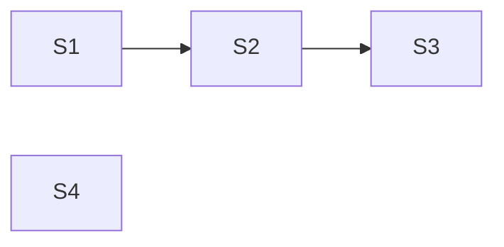

**Issue:** #233 — Table: keep the focused position valid when rows or columns change
**Branch:** feat/233-focus-recovery
**Worktree:** .claude/worktrees/feat-233-focus-recovery

Dependency: S1 → S2 → S3. Parallel-safe: S4 with any step.

| Step | Title                                                                                    | Status    |
| ---- | ---------------------------------------------------------------------------------------- | --------- |
| 1    | [Focus recovery — rows and columns](step-1-recovery-rows-columns.plan.md)                | ✅ done   |
| 2    | [Collapse recovers to the nearest visible ancestor](step-2-collapse-to-ancestor.plan.md) | ⬚ pending |
| 3    | [Closed panel recovers to its row](step-3-closed-panel-to-row.plan.md)                   | ⬚ pending |
| 4    | [Document focus recovery](step-4-recovery-docs.plan.md)                                  | ✅ done   |
