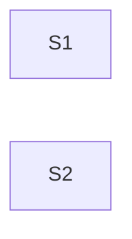

**Issue:** #234 — Table: single-open panel follows the focused position
**Branch:** feat/234-expansion-follow-focus
**Worktree:** .claude/worktrees/feat-234-expansion-follow-focus

Parallel-safe: S1, S2 — no edges

| Step | Title                                                                     | Status  |
| ---- | ------------------------------------------------------------------------- | ------- |
| 1    | [Single-open panel follows focus](step-1-expansion-follows-focus.plan.md) | ✅ done |
| 2    | [Document the follow-focus rule](step-2-follow-focus-docs.plan.md)        | ✅ done |
