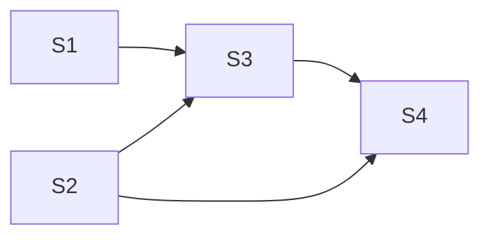

**Issue:** #235 — Table: grid role, roving tabindex and arrow-key navigation on body cells
**Branch:** feat/235-grid-navigation-core
**Worktree:** .claude/worktrees/feat-235-grid-navigation-core

Parallel-safe: [S1, S2] first; S3 after both; S4 after S3.

| Step | Title                                                            | Status    |
| ---- | ---------------------------------------------------------------- | --------- |
| 1    | [Key map, pure](step-1-key-map.plan.md)                          | ✅ done   |
| 2    | [Roles + roving tabindex](step-2-roles-roving-tabindex.plan.md)  | ✅ done   |
| 3    | [Keys, click and DOM focus](step-3-keys-click-dom-focus.plan.md) | ⬚ pending |
| 4    | [Grid navigation docs](step-4-grid-nav-docs.plan.md)             | ⬚ pending |
