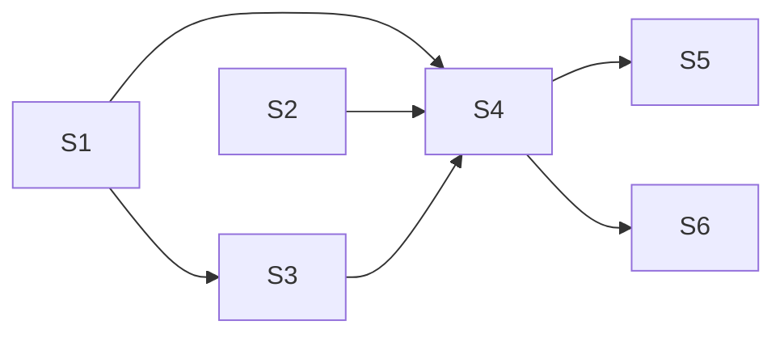

**Issue:** #236 — Table: header row, Page Up/Down and RTL in grid navigation
**Branch:** feat/236-header-paging-rtl
**Worktree:** .claude/worktrees/feat-236-header-paging-rtl

Parallel-safe: [S1, S2] first; S3 after S1 (shares the HeaderCell type); S4 after S1-S3; S5 and S6 after S4. S6 also waits for #237 to merge.

| Step | Title                                                                    | Status    |
| ---- | ------------------------------------------------------------------------ | --------- |
| 1    | [Key map: header, paging, RTL](step-1-key-map-header-paging-rtl.plan.md) | ✅ done   |
| 2    | [Page step and direction](step-2-page-step-and-direction.plan.md)        | ✅ done   |
| 3    | [Header cell focus targets](step-3-header-cell-focus-targets.plan.md)    | ✅ done   |
| 4    | [Header, paging, RTL keys](step-4-header-paging-rtl-keys.plan.md)        | ✅ done   |
| 5    | [Header, paging, RTL docs](step-5-header-paging-rtl-docs.plan.md)        | ✅ done   |
| 6    | [Header widgets](step-6-header-widgets.plan.md)                          | ⬚ pending |
