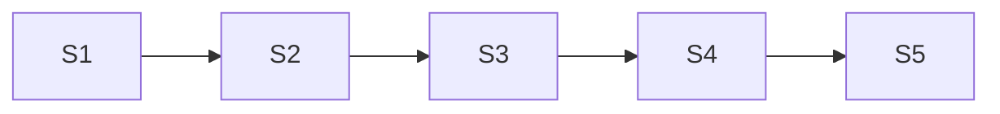

# Progress — #237 widgets in cells

**Issue:** [#237](https://github.com/DvirMon/ng-table/issues/237) — Table: focus widgets inside cells without breaking the single Tab stop
**Branch:** `feat/237-widgets-in-cells`
**Worktree:** `.claude/worktrees/feat-237-widgets-in-cells`

Dependency: S1 → S2 → S3 → S4 → S5 (S2–S4 all edit the keydown/focus handling in `ngp-table.directive.ts`; nothing is parallel-safe).

| Step                                        | Title                                                      | Status    |
| ------------------------------------------- | ---------------------------------------------------------- | --------- |
| [1](./step-1-cell-widgets-tabindex.plan.md) | Find a cell's widgets and keep them out of the Tab order   | ✅ done   |
| [2](./step-2-single-widget-cell.plan.md)    | A cell with one widget focuses that widget                 | ✅ done   |
| [3](./step-3-composite-cell-modes.plan.md)  | Enter and leave a cell with text inputs or several widgets | ✅ done   |
| [4](./step-4-nested-grid-keys.plan.md)      | A nested grid is ordinary content of a multi-widget cell   | ✅ done   |
| [5](./step-5-widgets-docs.plan.md)          | Docs: widgets in cells                                     | ⬚ pending |
