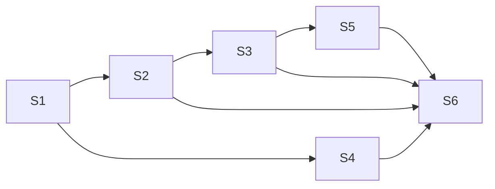

**Issue:** #239 — Table: treegrid row focus, expand and collapse by keyboard
**Branch:** feat/239-treegrid-row-navigation
**Worktree:** .claude/worktrees/feat-239-treegrid-row-navigation

Parallel-safe: [S4] alongside S2 → S3 → S5 after S1; S2, S3, S5 share ngp-table.directive.ts, so they are chained; S6 after all.

| Step | Title                                                                        | Status       |
| ---- | ---------------------------------------------------------------------------- | ------------ |
| 1    | [Treegrid role and row focus](step-1-treegrid-role-row-focus.plan.md)        | ✅ done |
| 2    | [Treegrid key map](step-2-treegrid-key-map.plan.md)                          | ✅ done |
| 3    | [Tree row ARIA and keys](step-3-tree-row-aria-keys.plan.md)                  | ✅ done |
| 4    | [Pointer-only toggle](step-4-pointer-only-toggle.plan.md)                    | ✅ done |
| 5    | [Row Tab walk](step-5-row-tab-walk.plan.md)                                  | ✅ done |
| 6    | [Treegrid row navigation docs](step-6-treegrid-row-navigation-docs.plan.md)  | ⬚ pending |
